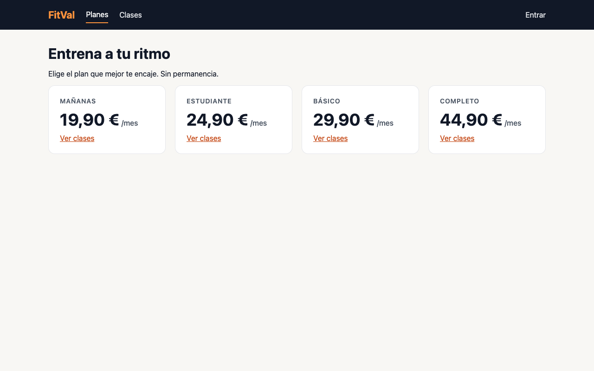
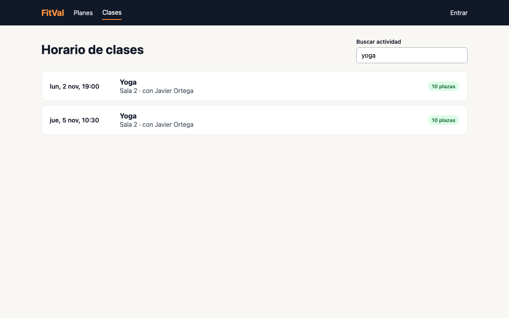
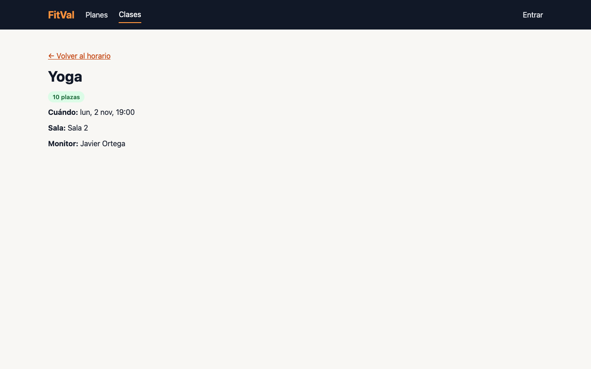
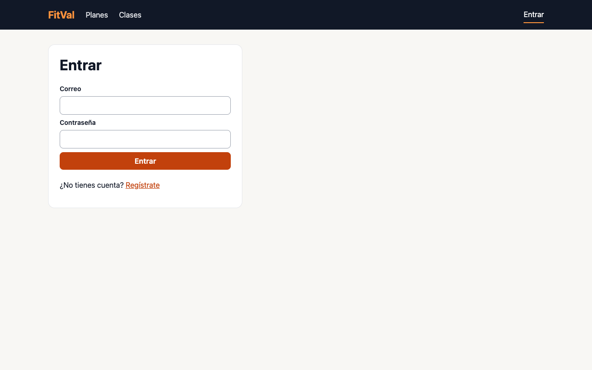
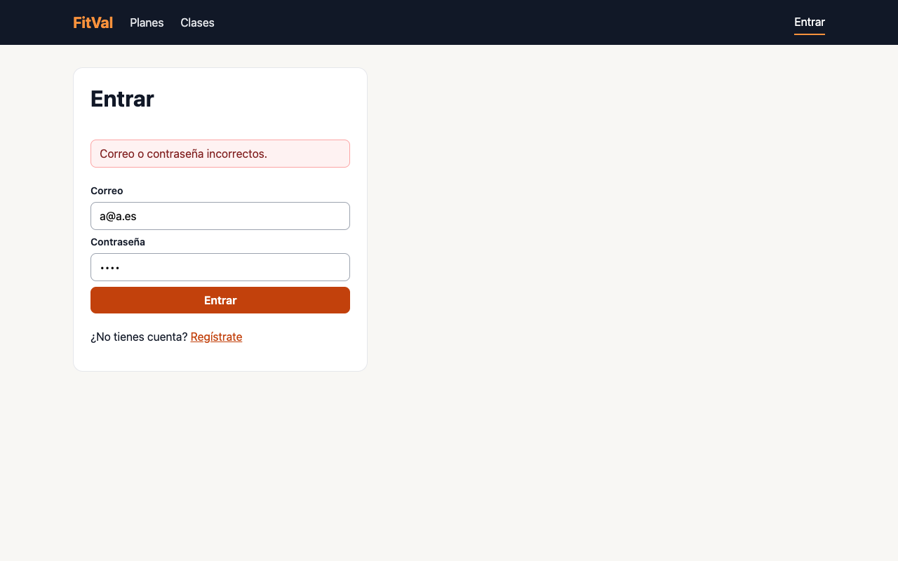
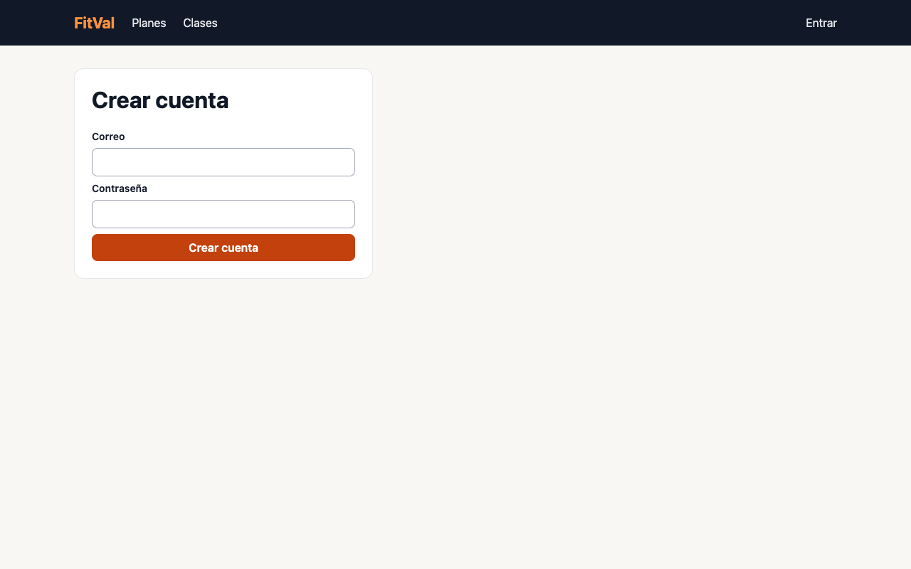
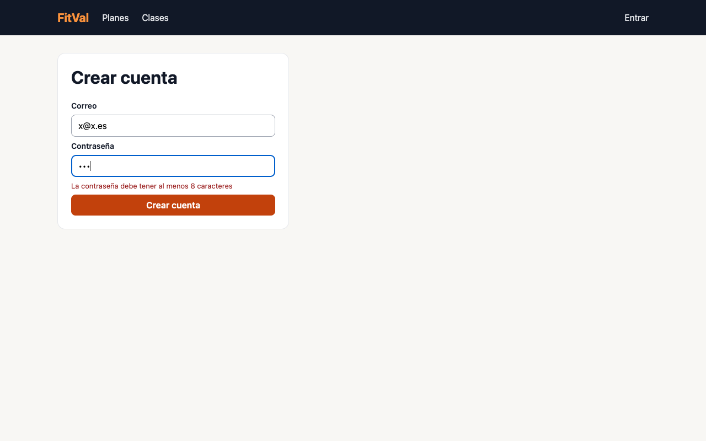
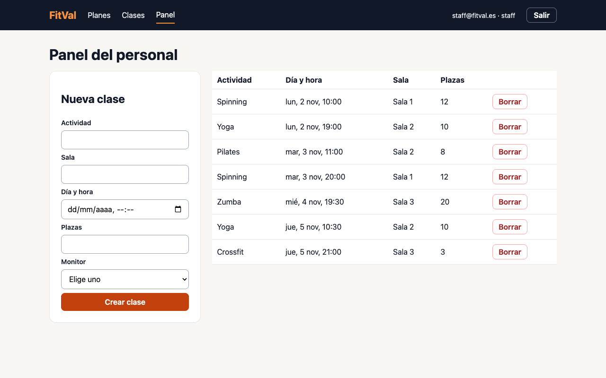

# FitVal Web

React web app for FitVal gym members (plans and class schedule) and staff (create and delete classes).

## Technologies

React, TypeScript, Vite, Redux Toolkit (RTK Query), React Router, React Hook Form, Zod, Vitest, Testing Library, json-server.

## Requirements

- Node.js 22 or newer
- npm

## Installation

```bash
npm install
cp .env.example .env
```

## Scripts

| Script | Description |
|---|---|
| `npm run api` | json-server on `http://localhost:3001` (uses `db.json`) |
| `npm run dev` | Vite dev server on `http://localhost:5173` |
| `npm run lint` | ESLint |
| `npm run build` | Type check and production build |
| `npm test` | Vitest in watch mode (`npx vitest run` for a single run) |

To run the app: start `npm run api` in one terminal and `npm run dev` in another.
To reset the data, copy `db.initial.json` over `db.json`.

Test users: `staff@fitval.es` / `staff1234` (staff), `lucia@gym.com` / `lucia1234` (member).

## Environment variables

| Variable | Description |
|---|---|
| `VITE_API_URL` | Base URL of the API (`http://localhost:3000/api` locally, the Render URL in production) |

Never commit `.env`; `.env.example` is committed.

## Project structure

```text
src/
  app/          store, RTK Query api, router, types, helpers
  components/   layout and shared UI
  features/     plans, classes, auth, staff
  test/         Vitest setup
```

## Deployment

- Web (Netlify): https://fitval-pablo.netlify.app
- API (Render): https://api-fitval-8wyd.onrender.com/api

Netlify: build command `npm run build`, publish directory `dist`, variable `VITE_API_URL`.
`public/_redirects` makes client-side routes work after a reload.

## Screenshots

| Page | Screenshot |
|---|---|
| Plans |  |
| Schedule filtered by `yoga` |  |
| Class detail |  |
| Login |  |
| Login error |  |
| Register |  |
| Register validation |  |
| Staff panel |  |

## Credits

Project for the TheBridge Full Stack Developer bootcamp.
